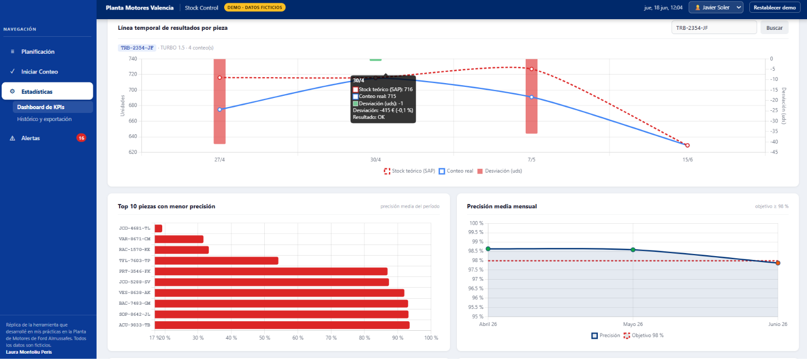

# Stock Control · Réplica de una app de control de inventario

Réplica interactiva, con **datos ficticios**, de la aplicación web que diseñé y desarrollé durante mis prácticas en la **Planta de Motores de Ford en Almussafes (Valencia)** para digitalizar el conteo cíclico y el control de inventario de las piezas de motor.

**[Probar la demo](https://lauramontoliuperis.github.io/stock-control-demo/)**

> **Aviso:** esta demo no contiene código, datos ni información de Ford. Todas las piezas, referencias, ubicaciones, motores y valores son inventados. Su objetivo es mostrar el funcionamiento y el diseño de la herramienta.

## El problema
En una planta de motores, el stock que registra el sistema (SAP) y el que hay físicamente en planta no siempre coinciden. El conteo cíclico (cada 4 meses) se hacía en papel: había que entrar adistintas paginas web, apuntar los datos, hacer operaciones a mano y calcular las diferencias. Era un proceso lento, con errores y difícil de seguir.

## La solución
Una aplicación web que guía el conteo paso a paso, calcula automáticamente las desviaciones frente al sistema y lanza alertas cuando superan unos umbrales. En la versión real **se eliminó por completo el papel del proceso** y los resultados se calculan en unos 5 segundos.

## Módulos

### 1. Planificación
- Calendario mensual de conteos según un excel de planificación (conteo cíclico: cada 4 meses)
- Estado de cada pieza (pendiente, contada o con alerta) y detalle al hacer clic.

### 2. Conteo
Flujo guiado en 5 pasos con cronómetro:
- **Información de la pieza:** Toda la información necesaria de la pieza para poder comenzar el conteo
- **Conteo físico:** almacén, puntos de uso en línea (OP 010…OP 110) y ubicaciones secundarias (AGV, re-embalaje, muestras en revisión…).
- **Conteo automático:** piezas incluidas en motores en proceso y terminados (motores × piezas por motor).
- **Comparación con el stock del sistema:** desviación en unidades, en euros y en porcentaje.
- **Clasificación automática del resultado:** Y guardado en la base de datos para alimentar al módulo 1, 3 y 4

| Estado | Regla |
|---|---|
| ✅ OK | Desviación ≤ 2 % |
| 🟠 Revisión | Más de 200 unidades **y** más de 1.000 € |
| 🔴 Crítica | Más de 3.000 € |

### 3. Estadísticas
- **10 KPIs:** precisión del inventario, conteos realizados, desviación total, tiempo medio de conteo, entre otros.
- Gráficos de evolución mensual, distribución por estado, piezas con mayor desviación, tiempos de conteo, precisión por familia de piezas y actividad por operario.
- Historial completo de conteos con **exportación a Excel**.

### 4. Alertas
- Bandeja de alertas críticas y de revisión, con historial.
- Acciones sobre cada alerta: **investigar**, **recontar** o **corregir**. Una corrección genera un nuevo registro y marca el original como sustituido, así que siempre queda trazabilidad.

## Datos de la demo
- Unas **500 piezas ficticias** de distintas familias (tornillería, tuercas, juntas, cables, etiquetas…), con referencia, ubicación, tipo de estantería, almacén y precio.
- **4 motores inventados** (app original 15) y 11 operaciones de línea (app original 500).
- Historial de conteos generado con una semilla aleatoria fija, así que la demo siempre arranca igual. La fecha de la demo está fijada en junio de 2026.
- Los cambios que hagas (conteos, correcciones…) se guardan en tu navegador. Con el botón **Reiniciar** vuelves al estado inicial.

## Tecnología

| | App original (Ford) | Esta demo |
|---|---|---|
| Lenguaje | Python, java, json, css (frontend, backend y API) | HTML, CSS y JavaScript |
| Datos | 4 bases de datos distintas integradas con Google BigQuery | Datos ficticios generados en el navegador |
| Gráficos y exportación | python · Excel| Chart.js · SheetJS (Excel) |
| Persistencia | Base de datos | `localStorage` del navegador |

La demo es un único archivo `index.html` sin dependencias que instalar: basta con abrirlo en el navegador.

## Autora
**Laura Montoliu Peris** · Científica de Datos · Máster en Planificación y Gestión de Procesos Empresariales (Universitat de València)
[LinkedIn](https://www.linkedin.com/in/laura-montoliu-peris/)
